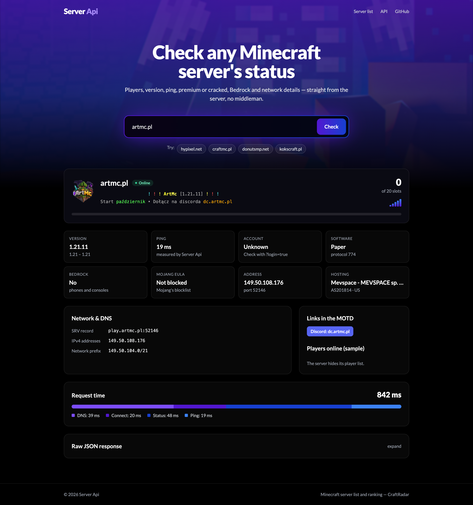

<!-- PROJECT LOGO -->
 

  
  <h3 align="center">McServerApi</h3>
  
    Check the status of any Minecraft server!
     
    <a href="https://status.craftradar.pl/">Preview</a>
    ·
    <a href="https://github.com/Wojtazzzz/mc_server_api/">View Code</a>
    ·
    <a href="https://github.com/Wojtazzzz/mc_server_api/issues/new?labels=bug&template=bug-report---.md">Report Bug</a>
    ·
    <a href="https://github.com/Wojtazzzz/mc_server_api/compare">Create Pull Request</a>
  

<!-- BUILT WITH -->
### Built With

* [Elixir](https://elixir-lang.org/)
* [Phoenix Framework](https://www.phoenixframework.org/)
* [Tailwind](https://tailwindcss.com/)

(<a href="#readme-top">back to top</a>)

<!-- ABOUT THE PROJECT -->
## About The Project

<!-- API -->
## API

`GET /api/status/:address` returns everything the server reveals about itself: status, players, MOTD (raw/clean/HTML), software, Query and Bedrock results, DNS and network info, EULA block status and, optionally, premium/no-premium mode. Every field is documented in the OpenAPI spec: browse it in Swagger UI at `/api/docs` or fetch the JSON from `/api/openapi`.
